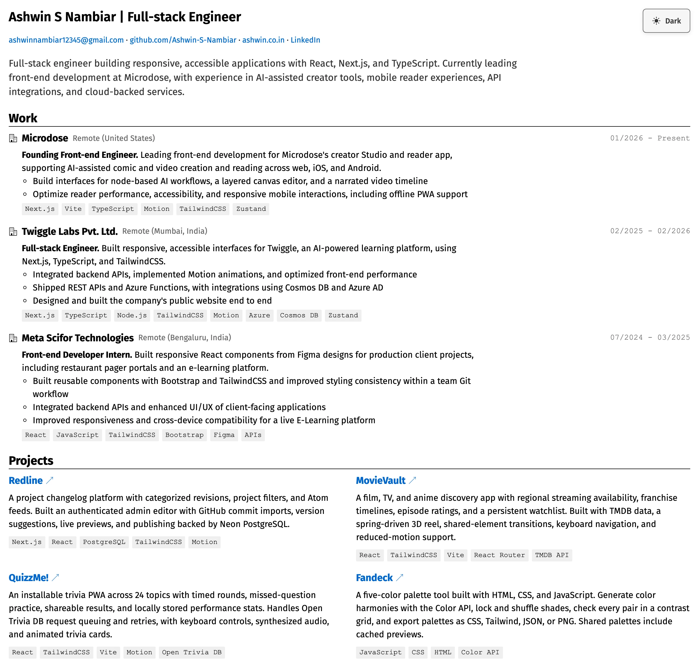
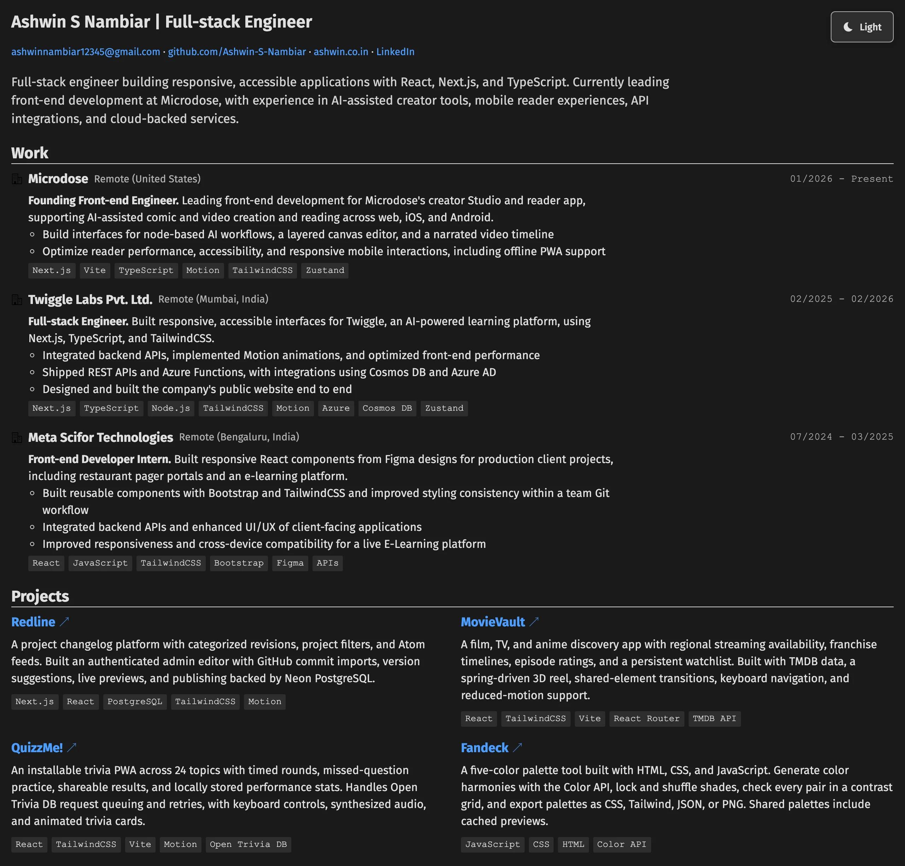
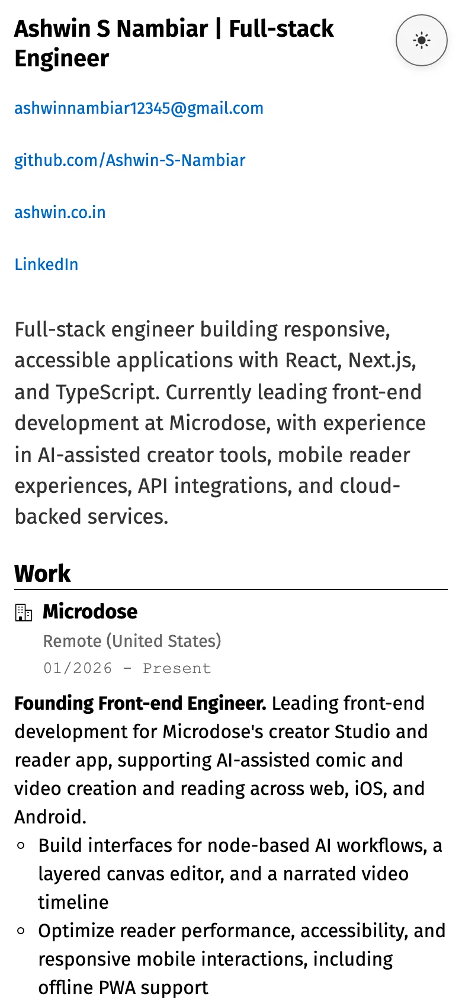

<p align="center">
  <a href="https://resume.ashwin.co.in">
    
  </a>
</p>

<p align="center">
  <a href="https://resume.ashwin.co.in"><strong>resume.ashwin.co.in</strong></a>
  &nbsp;·&nbsp;
  <a href="#what-it-does">what it does</a>
  &nbsp;·&nbsp;
  <a href="#the-design">the design</a>
  &nbsp;·&nbsp;
  <a href="#running-it">running it</a>
</p>

<br>

the source of **[resume.ashwin.co.in](https://resume.ashwin.co.in)**. my resume, on the web.

work, projects, education, certifications and skills on one page. it is plain html and css, with a little javascript to remember which theme you picked. the content lives in the page itself, so updating a role or a project means editing one file.

## what it does

- **the resume.** current and past roles, selected projects, education and technical skills, with links to the live projects and certificates.
- **contact.** email, github, portfolio and linkedin at the top.
- **light and dark.** starts in light mode. the toggle saves your choice in `localStorage`, so it stays that way when you come back.
- **print.** the browser's print command uses a compact, light layout and hides the theme toggle. save as pdf from the same dialog.

## the design

a document you can scroll through. thin rules separate the sections, blue marks the links, and small grey tags carry the technologies.

- **type.** fira sans for the text, courier for dates and tags. body text stays at a readable size on phones, and long links and tags wrap.
- **layout.** work and education read from top to bottom. projects and skills sit in two columns on desktop and become one on smaller screens. the page has a maximum width, and the theme button has its own space in the header.
- **themes.** white paper in light mode, charcoal in dark. both use the same layout and blue links.
- **interaction.** larger touch targets on phones and touchscreens, visible keyboard focus, and a labelled theme button even when only its icon is shown.
- **motion.** short colour transitions on the theme, links and tags, with underlines appearing on hover. reduced motion turns the transitions off.

<details>
<summary><strong>dark mode and mobile</strong></summary>

<br>

<p align="center">
  
</p>

<p align="center">
  
</p>

</details>

## the stack

| layer | choices |
| --- | --- |
| page | html, with the resume written directly into it |
| style | css nesting, grid, flexbox, custom properties and print rules |
| interaction | vanilla javascript, `localStorage` for the theme |
| type | fira sans from google fonts, with local fallbacks |

## running it

```sh
git clone https://github.com/Ashwin-S-Nambiar/resume.git
cd resume
python3 -m http.server 8000
```

open [localhost:8000](http://localhost:8000). no packages to install or build step. opening `index.html` directly works for reviewing the page too.

## the shape of it

```text
index.html        the resume and theme toggle
style.css         layout, both themes, mobile and print rules
images/           favicons, app icons and the organization icon
favicon.ico       browser favicon
site.webmanifest  app name, colours and icons
docs/screenshots/ the README images
```

## updating it

edit `index.html` for the content and links, `style.css` for the presentation. check desktop and phone widths, both themes, and print preview after a change. refresh the screenshots when the visible content changes.

if you use it for your own resume, replace the contact links, canonical url, page description, icons and manifest details too.

[mit](LICENSE).

---

[resume.ashwin.co.in](https://resume.ashwin.co.in) · [ashwin.co.in](https://ashwin.co.in) · [notes](https://inspect.ashwin.co.in) · [x](https://x.com/ashwinnambiar11) · [github](https://github.com/Ashwin-S-Nambiar)
